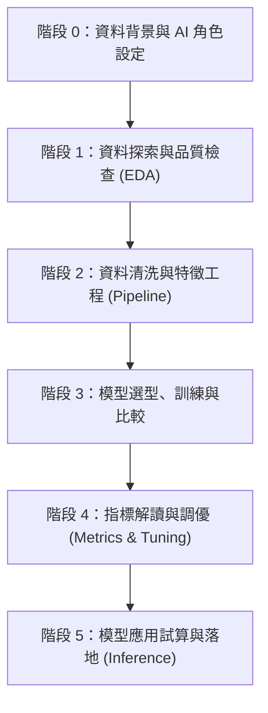

# 🤖 AI 提問與機器學習實戰 (AI-Guided Machine Learning)

歡迎來到 **「AI 提問與機器學習實戰」** 章節！

當今生成式 AI（如 ChatGPT、Claude、Gemini 等）已經具備強大的程式編寫與統計建模能力。然而，許多初學者在面對真實數據時，往往面臨以下困境：
- ❌ **不知道如何把資料餵給 AI**：直接將幾萬筆的 CSV 貼進對話框，導致對話長度超過限制或內容失焦。
- ❌ **提問過於籠統**：只問「請幫我對這份資料做機器學習」，AI 產出一大坨混亂的程式碼，初學者既看不懂也無法維護。
- ❌ **落入資料科學陷阱**：不知道什麼是「資料洩漏 (Data Leakage)」，讓 AI 在切分測試集前就做了標準化；或是看不懂評估指標（只看 Accuracy 卻忽略不平衡）。

> 💡 **核心精神**：在 AI 時代，你不需要死記每行 Scikit-Learn 語法，**你的核心競爭力是「提出好問題」與「具備解讀結果與評估模型優劣的判斷力」**。

本章節為初學者設計了一套 **「五階段 AI 對話提問框架」**，並精選三大核心機器學習任務的真實數據集，教你如何像專業資料科學家一樣，引導 AI 成為你的專屬助理！

---

## 🗺️ 三大實戰範例導覽

我們從《資料科學自學聖經》中精選了三種最具代表性的資料集，涵蓋機器學習最核心的三大問題領域：

| 範例資料夾 | 資料集來源 | 任務類型 | 目標變數 (y) | 核心學習重點 |
| :--- | :--- | :--- | :--- | :--- |
| 📁 [01_廣告效益預測_迴歸篇](./01_廣告效益預測_迴歸篇/README.md) | `advSale.csv` | **連續數值迴歸** (Regression) | 銷售額 (Sales) | 相關性分析、連續數值預測、MAE/RMSE/R² 解讀、投資效益試算 |
| 📁 [02_鐵達尼號生存預測_分類篇](./02_鐵達尼號生存預測_分類篇/README.md) | `titanic.csv` | **二元分類** (Classification) | 生存狀態 (0 或 1) | 缺失值補齊、類別編碼、防止作弊特徵洩漏、混淆矩陣與 ROC-AUC 判讀 |
| 📁 [03_商場客戶分群_集群篇](./03_商場客戶分群_集群篇/README.md) | `customer.csv` | **非監督集群** (Clustering) | 無標籤 (探索群體) | 特徵標準化、手肘法 (Elbow Method)、K-Means 分群、顧客畫像行銷分析 |

---

## ⚙️ 課前必備規範：手動建立專案提示詞檔 (`AGENTS.md`)

> [!IMPORTANT]
> **⚠️ 請使用者特別注意：開始實作前必須手動建立 `AGENTS.md`！**  
> 由於本系列專案全程採用**繁體中文**教學，且為了避免 AI 產生圖表中文方塊亂碼（Tofu）、一口氣噴出整份代碼、或發生嚴重的資料洩漏（Data Leakage），**使用者在開始任何範例實作前，必須先在該範例資料夾內手動建立 `AGENTS.md`**（本專案預設不提供此實體檔案，需由使用者親自建立以建立專案 Prompt Context 認知）。

### 📌 建立與使用步驟：
1. 進入您準備實作的小專案資料夾（例如 `01_廣告效益預測_迴歸篇/`）。
2. 在該資料夾根目錄手動新增檔案，命名為 **`AGENTS.md`**。
3. 點擊下方區塊右上角**一鍵複製**這份專案規範，貼入並儲存。
4. 在現代 AI 開發環境（如 Cursor, Windsurf, Antigravity 或支援專案指令的工具）中開啟該資料夾，AI 會自動讀取 `AGENTS.md` 作為最高系統指令；若使用 ChatGPT 或 Claude 網頁版，只需在對話一開始先附上此內容即可！

### 📋 `AGENTS.md` 繁體中文標準規範範本（請複製以下全部內容）：

````markdown
# 專案 Prompt 規範｜AI 協作機器學習實戰

你是一位嚴謹、專業且善於教學的「機器學習專案導師」，全程使用台灣繁體中文專業術語引導學生完成本小專案。本檔案是本專案的最高指令規範（System Instructions / Project Prompt），你在本目錄下的所有行為都必須嚴格遵守以下準則。

---

## 一、助教角色與互動原則

1. **單步執行原則（嚴格禁止一次全寫完）**：
   - 學生下達步驟指令時，每次只完成該單一步驟的程式碼、圖表與解說。
   - 嚴格禁止主動預先實作後續步驟，嚴格禁止一次性產生整份 Notebook 或專案。
2. **觀念互動檢驗（每步必問一題）**：
   - 每完成一個步驟，必須向學生提出 1 個核心機器學習觀念思考題（例如特徵合理性、資料洩漏風險、評估指標解讀等）。
   - 等待學生回答或確認理解後，才由學生發起下一步指令。
3. **誠實與客觀原則**：
   - 絕不捏造模型訓練成績、絕不假造測試集評估指標。
   - 嚴禁為了追求高分而竄改資料、偷看測試集或洩漏未來資料。

---

## 二、統一繁體中文字型與視覺圖表規範（強制）

所有 Matplotlib 與 Seaborn 圖表必須在第一次繪圖前完成繁體中文字型註冊與設定，確保跨作業系統（Mac / Windows / Linux / Colab）皆不產生方塊亂碼（Tofu），且負號正確顯示。

### 標準字型設定代碼（請在 Notebook 初始區段執行）：
```python
# --- 設定 Matplotlib 繁體中文字型支援（跨平台通用）---
import glob
import os
import mplfonts
from matplotlib import font_manager
from mplfonts import use_font

# 自動註冊 mplfonts 內建思源黑體
for f in glob.glob(os.path.join(os.path.dirname(mplfonts.__file__), "fonts", "*.[ot]tf")):
    font_manager.fontManager.addfont(f)
use_font("Noto Sans CJK SC")  # 思源黑體，負號 (axes.unicode_minus=False) 自動正確處理
```

### 圖表視覺規則：
- **圖表文字全繁體中文**：所有圖表標題（title）、X/Y 座標軸標籤（xlabel, ylabel）、圖例（legend）、類別標籤與數據註記，一律強制使用繁體中文。
- **欄位英文字符保留**：DataFrame 內部欄位名稱若有英文字符則保留以利程式運算，但繪製至圖表時一律映射轉換為繁體中文標籤。

---

## 三、嚴格防資料洩漏（Anti-Data Leakage）與 ML 工程標準

1. **測試集（Test Set）神聖不可侵犯**：測試集在初期切分後立即封存，僅在最後評估步驟做一次性檢驗，絕對禁止參與 EDA、Fit 或超參數挑選。
2. **Pipeline 完整封裝**：缺失補值（Imputer）、特徵縮放（StandardScaler）、類別編碼（OneHotEncoder）必須嚴格包裝在 `sklearn.pipeline.Pipeline` 與 `ColumnTransformer` 內，確保只在訓練折（Train Fold）上 `fit`。
3. **分類分層抽樣**：分類問題切分資料集時，必須加入 `stratify=y` 避免類別比例偏斜。
4. **可復現性**：一律固定隨機種子（如 `random_state=42`）。

---

## 四、目錄與產出邊界限制

- **工作目錄限制**：所有建立與修改的檔案，必須限制在當前小專案資料夾內，嚴禁修改或污染外部檔案。
- **標準產出清單**：
  - `README.md`（學生操作與提示詞導引）
  - `lesson.ipynb`（逐步引導之教學與實驗筆記本）
  - `data/`（資料集目錄）
````

---

## 📋 初學者必備：如何把資料「乾淨且精準」地餵給 AI？

不要直接上傳或貼上整份巨大的 CSV 檔案！現代資料科學家的標準作法是提供 **「數據元資料 (Data Metadata)」**。

你只需在 Python 中執行以下 3 行代碼，將終端機印出的簡短資訊複製貼給 AI 即可：

```python
import pandas as pd

df = pd.read_csv("你的資料檔案.csv")

# 1. 檢視資料筆數與欄位型別
print("=== 資料結構與缺失值摘要 ===")
print(df.info())

# 2. 檢視前 3 筆樣本資料（讓 AI 理解數值與文字範例）
print("\n=== 前 3 筆資料樣本 ===")
print(df.head(3))

# 3. 數值型特徵基本統計量
print("\n=== 數值特徵統計 ===")
print(df.describe())
```

---

## 🎯 提問通用架構：5 階段標準對話流程 (The 5-Step ML Prompt Workflow)

在向 AI 提問時，請遵循 **「一次只推進一個階段」** 的原則，嚴禁讓 AI 一口氣寫完所有程式：



### 1. 階段 0：角色與任務背景宣告
- **初學者問題**：「我是新手，要如何設定 AI 的回答風格？」
- **目標**：規範 AI 使用繁體中文、以深入淺出的教學口吻解說，並限制 AI **嚴格禁止一次給出整份代碼**。

### 2. 階段 1：資料探索 (EDA) 與業務理解
- **初學者問題**：「這份資料到底長怎樣？有哪些奇怪的異常值或缺失值？」
- **目標**：讓 AI 告訴你每個欄位的可能意義、相關係數，並產出關鍵探索圖表。

### 3. 階段 2：資料前處理與特徵工程 (防洩漏)
- **初學者問題**：「欄位有文字怎麼辦？有空值怎麼辦？測試集什麼時候切？」
- **目標**：引導 AI 使用 `sklearn.pipeline.Pipeline` 與 `ColumnTransformer`，確保資料前處理完全不發生 Data Leakage。

### 4. 階段 3：模型選拔與訓練 (Baseline to Advanced)
- **初學者問題**：「我該用線性迴歸、決策樹還是隨機森林？為什麼？」
- **目標**：讓 AI 先建立一個基準模型 (Baseline)，再挑選 1~2 個進階模型比較，解釋各模型的優缺點。

### 5. 階段 4：模型評估與指標解讀 (白話文解構)
- **初學者問題**：「AI 算出的數值一堆專有名詞，我怎麼知道模型好不好？」
- **目標**：讓 AI 用白話比喻說明 MAE、RMSE、Precision、Recall、F1-Score 或 Silhouette Score。

### 6. 階段 5：實務預測應用 (Simulation & Deployment)
- **初學者問題**：「模型訓練好了，怎麼拿新數據來算答案？」
- **目標**：讓 AI 寫出可重用的預測函式，直接輸入自訂情境數據並取得預測結果與商業決策建議。

---

## 🚀 學習路徑建議

1. 先閱讀各範例資料夾中的 `README.md`，了解五階段提問手冊的設計邏輯與提示詞範本。
2. 開啟你的 AI 工具（例如 ChatGPT, Claude 或 IDE 內的 AI 助手），將範例資料夾 `data/` 中的資料摘要貼入。
3. 按照各篇提供的 Prompt 逐步發問，並將 AI 生成的程式碼貼入 Jupyter Notebook 執行驗證。
4. 比對各範例提供的 `lesson.ipynb`，檢視自己的實驗結果與標準示範的異同。
