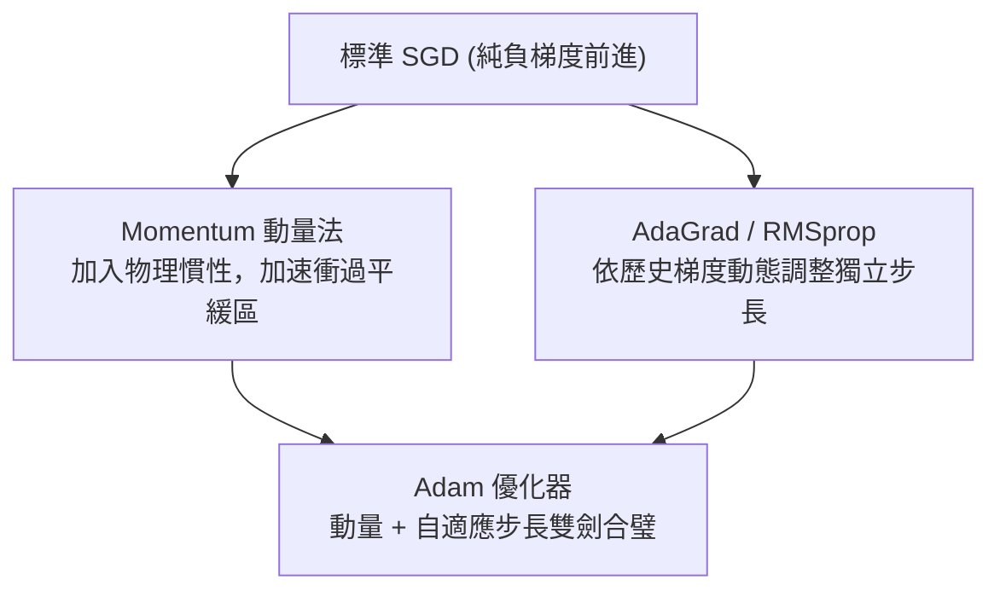

# 6. 優化算法 (Optimization Algorithms)

<!-- interactive-glossary:start -->

🌐 **[開啟本章互動動畫教學](https://roberthsu2003.github.io/machine_learning/glossary/06-optimization/)**

動畫場景：[梯度下降](https://roberthsu2003.github.io/machine_learning/glossary/06-optimization/#gradient-descent) · [學習率](https://roberthsu2003.github.io/machine_learning/glossary/06-optimization/#learning-rate) · [Batch／SGD／Mini-batch](https://roberthsu2003.github.io/machine_learning/glossary/06-optimization/#batch-size) · [優化器補充](https://roberthsu2003.github.io/machine_learning/glossary/06-optimization/#optimizers)

<!-- interactive-glossary:end -->

在機器學習中，模型一開始的參數通常是隨機初始化的（預測結果往往荒腔走板）。  
**優化算法（Optimizer）就是引導模型參數從「一無所知」走向「精準預測」的導航儀**，它的任務是沿著損失函數的地形，找到讓預測誤差最小化的一組最佳參數 $\theta^*$。

---

## 🎯 本章學習目標
1. 掌握**梯度下降法 (Gradient Descent)** 的數學直覺與幾何物理意義。
2. 搞懂**學習率 ($\alpha$)** 的步長效應，理解震盪與發散的原因。
3. 熟悉 **Batch Size（批次大小）** 的性能與泛化權衡，通曉常用優化器的演進脈絡。

---

## 1. 梯度下降法 (Gradient Descent)

### 核心定義
梯度下降法是一種基於一階導數的數值迭代優化算法。它計算損失函數 $J(\theta)$ 對參數 $\theta$ 的**梯度向量 $\nabla J(\theta)$**，並沿著**負梯度方向（局部最陡峭下降方向）**更新參數，步步逼近損失函數的極小值點。

### 💡 生活直觀比喻：濃霧中盲眼摸索下山
> 想像你被蒙上雙眼、置身於濃霧瀰漫的群山之中，任務是走到地勢最低的山谷底部。  
> 雖然你看不到全貌，但你可以用腳感受腳下地面的傾斜坡度（計算梯度）。  
> 只要**每一次都朝著腳下最陡的斜坡向下跨出一小步（沿負梯度前進）**，持續反覆這一步驟，最終就能抵達山谷盆地！

#### 📊 觀念圖解
> 🎬 互動動畫：[梯度下降](https://roberthsu2003.github.io/machine_learning/glossary/06-optimization/#gradient-descent)

---

### 核心參數更新公式

$$\theta_{\text{new}} = \theta_{\text{old}} - \alpha \cdot \nabla J(\theta)$$

- $\theta$：模型參數（如權重 $w$ 與偏置 $b$）。
- $\nabla J(\theta)$：損失函數對參數的偏微分梯度（決定**前進方向**，數值為正表示向右上升，減去它即向左下降）。
- $\alpha$：**學習率 (Learning Rate)**，決定每次更新的**步伐大小 (Step Size)**。

---

### 梯度下降的三大實戰變體

| 變體名稱 | 每次更新使用的數據量 | 💡 比喻 | 優點 | 缺點 |
| :--- | :--- | :--- | :--- | :--- |
| **批次梯度下降 (Batch GD, BGD)** | **全部訓練樣本 (100%)** | 收集全校所有學生意見後才做決定 | 梯度估算精準，路徑平滑直達極值點。 | 當數據量龐大（數百萬筆）時，單步計算極其緩慢且耗盡記憶體。 |
| **隨機梯度下降 (Stochastic GD, SGD)** | **僅隨機抽取單一筆樣本 ($N=1$)** | 走在路上隨機抓一個路人問話就做決定 | 每步計算極快，具強烈隨機噪聲，容易跳出局部鞍點。 | 更新路徑劇烈劇烈震盪，難以平穩收斂在最低點。 |
| **小批次梯度下降 (Mini-Batch GD)** | **隨機抽取一小批樣本 (如 32, 64, 128)** | 每次抽樣一個小組（如 32 人）開會定案 | **兼具 BGD 的穩定度與 SGD 的高速度**，能充分利用 GPU 並行加速。 | 需要額外調整 Batch Size 超參數。當前深度學習絕對標準首選！ |

---

## 2. 學習率 (Learning Rate, $\alpha$)

學習率是優化算法中最核心、最敏感的超參數。

#### 📊 觀念圖解
> 🎬 互動動畫：[學習率](https://roberthsu2003.github.io/machine_learning/glossary/06-optimization/#learning-rate)

### 步長大小引發的性能光譜

### 實務調優策略
1. **典型初始值**：常見的嘗試起點為 `0.001`、`0.01`。
2. **學習率衰減 (Learning Rate Decay / Scheduling)**：
   - 訓練初期（離谷底尚遠）：使用較大學習率大步快跑。
   - 訓練後期（接近最優點）：動態調小學習率（如 Cosine Annealing），細緻落入谷底最深處。

---

## 3. 批次大小 (Batch Size)

#### 📊 觀念圖解
> 🎬 互動動畫：[Batch／SGD／Mini-batch](https://roberthsu2003.github.io/machine_learning/glossary/06-optimization/#batch-size)

[查看原始 PNG 圖片](images/03_batch_size_comparison.png)

### 💡 直觀理解：民調抽樣的比喻
- **大批次（如 512, 1024 / 大規模民調）**：問話人次多，誤差小，決策方向穩如泰山；但耗費大量記憶體 (VRAM)。有時過於「拘謹」，容易跌入尖銳的局部不良極值（泛化稍差）。
- **小批次（如 16, 32 / 街頭隨機抽問幾人）**：問話速度極快，記憶體佔用極低。雖然每次更新的方向有些搖晃震盪，但**適度的噪聲反而能將模型震出平庸的淺坑（鞍點），尋找到更寬廣、泛化更好的全局平坦最優谷底**！

> [!TIP]
> **GPU 硬體加速法則**：  
> 在配置 Batch Size 時，幾乎總是設定為 **2 的次方數**（如 16, 32, 64, 128, 256, 512）。這是因為 GPU 的硬體計算單元（CUDA Cores / Tensor Cores）在 2 的次方記憶體對齊下吞吐效率最高！

### 🔗 深度連動：三大變體（Batch Size）與學習率 ($\alpha$) 的關係

在參數更新公式 $\theta_{\text{new}} = \theta_{\text{old}} - \alpha \cdot \nabla J(\theta)$ 中，步長實際上是由**「學習率 $\alpha$」與「梯度估計值 $\nabla J$」相乘決定**的。不同的梯度變體本質上代表了不同的 Batch Size，這與學習率的設定有著極為關鍵的連動：

1. **梯度噪聲決定學習率容忍度**：
   - **BGD（全數據）**：梯度估計極為平滑精準，沒有抽樣噪聲。因為方向可信度高，可以使用**相對較大、較激進的學習率**。
   - **SGD（單一樣本）**：梯度帶有巨大的隨機噪聲。若學習率設得太大，噪聲會被劇烈放大導致參數在山谷兩側瘋狂震盪甚至發散；因此 SGD 需要**較保守、較小的學習率**。
   - **Mini-Batch GD**：兼具平滑度與探索噪聲，是標準學習率（如 `0.001`）的最佳拍檔。

2. **「天然煞車」vs.「強制降速」機制**：
   - **BGD 具備天然煞車**：當模型接近谷底極值點時，真實梯度自然趨近於 0（$\nabla J(\theta) \to 0$）。因此即使學習率固定不變，每步的移動量也會自動遞減，自然停入谷底。
   - **Mini-Batch / SGD 必須手動減速**：即使模型已抵達全體數據的谷底中心，由於每次抽樣樣本不同，單一批次的梯度**永遠不會剛好為 0**（存在殘留方差）。如果不搭配**學習率衰減 (Learning Rate Decay)** 把 $\alpha$ 調小，模型就會永遠在谷底周圍打轉晃動無法收斂。

3. **線性縮放原則 (Linear Scaling Rule)**：
   - 在分散式訓練或擴大 Batch Size 時，實務上的經典法則為：**當 Batch Size 放大 $k$ 倍時，學習率 $\alpha$ 通常也需要等比例放大 $k$ 倍（或開根號 $\sqrt{k}$ 倍）**。
   - **核心邏輯**：批次越大，梯度方向越準確，且每個 Epoch 的更新次數減少了。為了維持相同的有效學習進度，每一步必須邁得更有信心、跨得更大。

| 變體 (Batch Size) | 梯度隨機噪聲 | 對學習率 ($\alpha$) 的要求 | 接近谷底時的行為 |
| :--- | :--- | :--- | :--- |
| **BGD (全部樣本)** | 無噪聲（方向極準確） | 可容忍較大 $\alpha$ | 梯度自然趨近 0，自帶天然煞車 |
| **SGD ($N=1$)** | 極大噪聲（更新劇烈晃動） | 需較小 $\alpha$，避免被噪聲震飛 | 殘留噪聲大，**必須衰減 $\alpha$** 才能穩定停在谷底 |
| **Mini-Batch** | 適度噪聲（兼具穩定與探索） | 依批次大小搭配（遵循線性縮放原則） | **必須衰減 $\alpha$**，以收斂至平坦最優點 |

---

## 4. 拓展視野：現代優化器家族演進

從純粹的梯度下降到現代頂尖優化器，演算法經歷了以下演進：

- **為什麼大家愛用 Adam？**：  
  Adam (Adaptive Moment Estimation) 同時保留了「慣性衝力（避免卡在鞍點）」與「自適應步長（頻繁變動的特徵小步走、罕見變動的特徵大步走）」，是目前大多數機器學習與深度學習任務中表現最魯棒、最省心的默認選擇！

---

## 📌 本章精華速記
1. **梯度下降**沿著損失函數最陡峭的反方向下山，推動參數持續走向最小誤差。
2. **學習率**決定前進步長；太小收斂牛步，太大震盪發散，適度配合衰減策略效果最佳。
3. **小批次 (Mini-batch)** 是現代工業界標準，兼顧計算效率、GPU 平行吞吐與噪聲泛化優勢。
4. 現代專案若不知從何選起，首選 **Adam 優化器** 作為穩健的強力起步基準。

---

[⏮️ 上一章：05_模型參數](../05_模型參數/README.md) | [📑 返回目錄](../README.md) | [⏭️ 下一章：07_常見算法](../07_常見算法/README.md)
