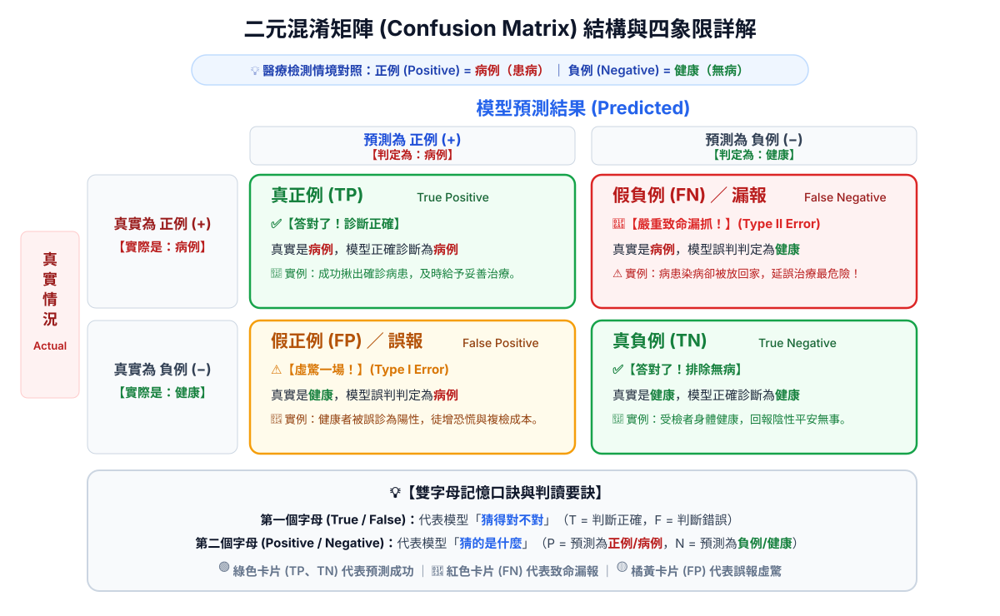
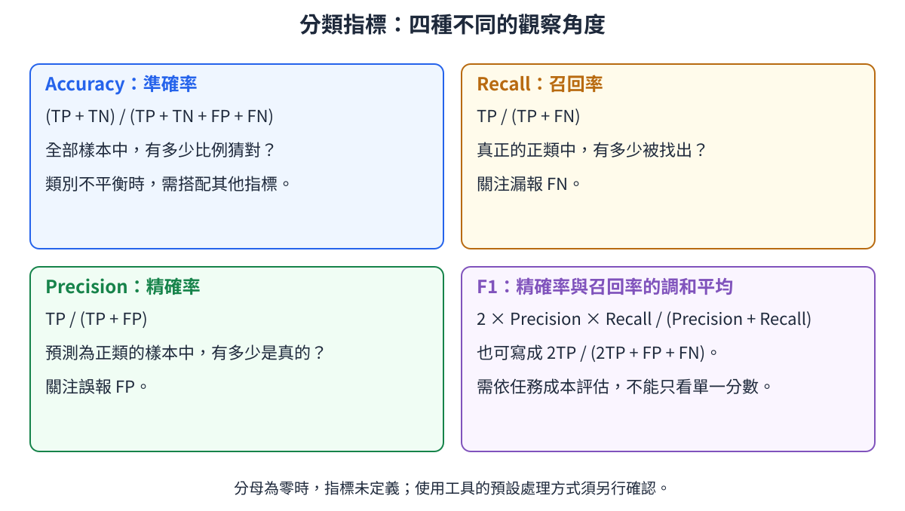
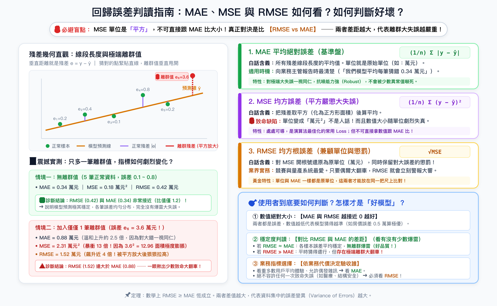
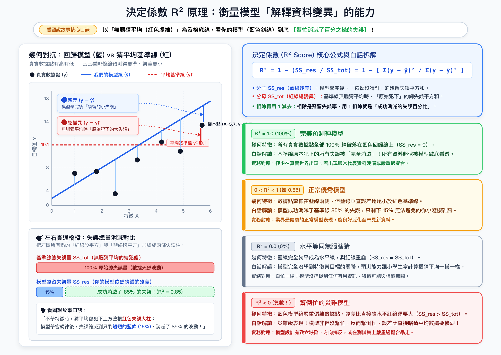

# 9. 評估指標 (Performance Metrics)

<!-- interactive-glossary:start -->

🌐 **[開啟本章互動動畫教學](https://roberthsu2003.github.io/machine_learning/glossary/09-evaluation-metrics/)** ·  · 📓 **[實作筆記本](./README.ipynb)**

動畫場景：[混淆矩陣](https://roberthsu2003.github.io/machine_learning/glossary/09-evaluation-metrics/#confusion-matrix) · [分類指標與 ROC](https://roberthsu2003.github.io/machine_learning/glossary/09-evaluation-metrics/#classification-metrics) · [MAE、MSE、RMSE](https://roberthsu2003.github.io/machine_learning/glossary/09-evaluation-metrics/#regression-errors) · [R²](https://roberthsu2003.github.io/machine_learning/glossary/09-evaluation-metrics/#r-squared)

<!-- interactive-glossary:end -->

在機器學習專案中，**評估指標（Evaluation Metrics）是用來客觀衡量模型品質、診斷學習盲點與推動模型調優的指南針**。

不同的任務型態（分類 vs 回歸）以及不同的商業場景代價（如漏報代價 vs 誤報代價），必須選用相應的指標。如果選錯了指標，即使模型分數看似高達 99%，在真實業務落地時也可能帶來災難性的虧損！

---

## 🎯 本章學習目標
1. 徹底理解**混淆矩陣 (Confusion Matrix)** 的四象限組成與雙字母記憶口訣。
2. 搞懂分類四大指標（Accuracy, Precision, Recall, F1）的核心關注點與取捨權衡（Tradeoff）。
3. 掌握回歸任務的核心量化指標（MAE, MSE, RMSE, $R^2$）的幾何意義與單位特點。

---

## 1. 分類評估指標 (Classification Metrics)

### 混淆矩陣 (Confusion Matrix)

混淆矩陣是一個二維交叉統計表，精確總結了分類模型的預測結果與真實情況，是所有分類衍生指標的基石。

#### 📊 觀念圖解
> 🎬 互動動畫：[混淆矩陣](https://roberthsu2003.github.io/machine_learning/glossary/09-evaluation-metrics/#confusion-matrix)

[查看原始 PNG 圖片](images/01_confusion_matrix.png)

### 四象限組成概念

| 象限名詞 | 英文全稱 | 真實情況 (+病例 / −健康) | 模型預測 (+病例 / −健康) | 💡 生活實例（醫療檢測） |
| :--- | :--- | :---: | :---: | :--- |
| **真正例 (TP)** | True Positive | **陽性 (+)【病例】** | **陽性 (+)【病例】** | 病患確實染病，檢測結果精確抓出為陽性（成功確診）。 |
| **真負例 (TN)** | True Negative | **陰性 (−)【健康】** | **陰性 (−)【健康】** | 受檢者完全健康，檢測結果回報為陰性（平安無事）。 |
| **假正例 (FP)** | False Positive *(Type I Error 第一型錯誤 / 誤報)* | **陰性 (−)【健康】** | **陽性 (+)【病例】** | 受檢者明明健康，檢測卻誤判為陽性（虛驚一場、冤枉好人）。 |
| **假負例 (FN)** | False Negative *(Type II Error 第二型錯誤 / 漏報)* | **陽性 (+)【病例】** | **陰性 (−)【健康】** | 病患確實染病，檢測卻漏判為陰性（**致命漏網之魚！**）。 |

> 💡 **雙字母記憶口訣**：
> - **第一個字母 (True / False)**：代表模型「**猜得對不對**」（T = 猜對，F = 猜錯）。
> - **第二個字母 (Positive / Negative)**：代表模型「**預測它是哪一類**」（P = 猜正類【病例】，N = 猜負類【健康】）。

---

### 分類四大衍生指標體系

#### 📊 觀念圖解
> 🎬 互動動畫：[分類指標與 ROC](https://roberthsu2003.github.io/machine_learning/glossary/09-evaluation-metrics/#classification-metrics)

[查看原始 PNG 圖片](images/02_classification_metrics.png)

---

### 1. 準確率 (Accuracy)
- **數學公式**：
  $$\text{Accuracy} = \frac{TP + TN}{TP + TN + FP + FN}$$
- **含義**：所有樣本中，被模型精確猜對的總比例。
- **🚨 致命陷阱：類別不平衡盲點**  
  > 假設某種罕見癌症在人口中患病率為 0.1%（1,000 人中只有 1 人得病）。  
  > 一個完全沒學習能力的「無腦模型」，不管誰來都全猜「健康 (Negative)」，其準確率依然高達 **99.9%**！但此模型對抓出病患毫無貢獻。因此**面對不平衡數據，絕對不能只看 Accuracy**！

---

### 2. 召回率 (Recall / 查全率 / Sensitivity)
- **數學公式**：
  $$\text{Recall} = \frac{TP}{TP + FN}$$
- **含義**：在所有**真實為正類**的樣本中，被模型成功抓出的比例。
- **關注焦點**：**極力消滅 FN（漏報）**！對應圖解右上角，寧可抓錯十個，也絕不能漏放一個。
- **經典應用場景**：
  - **惡性腫瘤篩檢**：若病患得癌卻被誤判為健康（FN），將延誤就醫導致喪命！
  - **信用卡盜刷風控**：寧可暫時凍結可疑交易打電話確認，也絕不讓盜刷成功。
  - **防空預警雷達**：寧可把大批海鳥誤判為敵機，也絕不能漏掉一枚真實飛彈。

---

### 3. 精確率 (Precision / 查準率)
- **數學公式**：
  $$\text{Precision} = \frac{TP}{TP + FP}$$
- **含義**：在所有**被模型猜測為正類**的樣本中，實際上真正為正類的比例。
- **關注焦點**：**極力消滅 FP（誤報）**！對應圖解左下角，寧可少猜，也絕不能冤枉好人。
- **經典應用場景**：
  - **垃圾郵件過濾**：把重要工作通知或銀行驗證碼信件當垃圾郵件丟掉（FP）的代價無法承受。
  - **法庭宣判定罪**：寧可放過嫌疑犯，絕不可冤枉無辜好人入獄。
  - **精準電商推薦**：推薦清單必須精準切中用戶喜好，避免打擾顧客。

---

### 4. F1 分數 (F1-Score)
- **數學公式**：
  $$\text{F1} = 2 \times \frac{\text{Precision} \times \text{Recall}}{\text{Precision} + \text{Recall}} = \frac{2TP}{2TP + FP + FN}$$
- **含義**：精確率與召回率的**調和平均數 (Harmonic Mean)**。
- **為什麼用調和平均，不用算術平均？**  
  調和平均數會對極端微小值施加嚴厲懲罰。如果 Precision 高達 99% 但 Recall 只有 1%，其算術平均為 50%，但 F1 分數會直接跌落至接近 2%！只有在兩者皆優異時，F1 才會高。
- **適用場景**：數據不平衡，且業務上同時需要兼顧準確性與覆蓋面的綜合評估。

---

### 5. ROC-AUC (受試者工作特徵曲線與曲線下面積)

在實務中，分類模型輸出的往往不是直接的「是/否」，而是「屬於正類的機率分數」（例如：預測這封信是垃圾信的機率為 0.78）。我們通常預設以 0.5 作為**分類門檻 (Threshold)**：大於等於 0.5 就判為正類。

但門檻不一定要設在 0.5。如果調整門檻，**精確率 (Precision)** 與 **召回率 (Recall)** 就會出現**此消彼長 (Trade-off)** 的關係：

> 💡 **生活小範例：醫院的「癌症早期篩檢」**
> - **先釐清正例與負例定義**：
>   - **正例 (Positive)**：**「罹癌／病例」**（我們關注重點、想主動找出的目標）。
>   - **負例 (Negative)**：**「健康／無病」**（一般正常狀態）。
>   - 模型輸出的是**「罹患癌症（正例）的機率分數」**。
> - **假設把門檻調低（例如降到 0.2）——「寧可錯抓，不能放過」**：
>   - 只要模型判定有 20% 的罹癌嫌疑，就全部判為正例（診斷為有病），叫來做進一步精密檢查。
>   - **結果**：幾乎所有真正的病患（真實正例）都被找了出來，漏診極少 ➔ **Recall（召回率 / 抓全率）大幅提高**！
>   - **代價**：許多健康的人（真實負例）也被誤判為有病（假正例 FP 增加，冤枉健康人），在所有被判定有病的人中真正罹癌的比例降低 ➔ **Precision（精確率 / 抓準率）下降**。
> - **假設把門檻調高（例如升到 0.8）——「證據確鑿，才敢斷定」**：
>   - 模型必須有高達 80% 的把握，才敢判定為正例（診斷為有病）。
>   - **結果**：只要被判定有病的人，幾乎百分之百真的是病患，很少冤枉健康人（假正例 FP 極少） ➔ **Precision（精確率 / 抓準率）大幅提高**！
>   - **代價**：那些病況不明顯（機率只有 30% ~ 70%）的真正病患全被判定為健康而漏掉了（假負例 FN 暴增） ➔ **Recall（召回率 / 抓全率）大幅下降**。
>
> 📌 **核心總結**：門檻就像一個「嚴格度調節旋鈕」——**門檻越低抓越全但越不準；門檻越高抓越準但越不全**。

- **兩個軸代表什麼意思？（收益 vs 代價）**：
  - 📈 **縱軸（Y 軸）TPR (真正例率 / Recall) ➔ 代表【收益 (Benefit)】**：
    - **含義**：模型為我們帶來的「好處與收穫」——**抓對正例（病例）的能力**（成功抓出的病患 / 全部真實病患）。
    - **期望**：**越高越好**，上限是 1.0（代表 100% 的病患都被精準抓出，及早治療拯救生命）。
  - 💸 **橫軸（X 軸）FPR (假正例率) ➔ 代表【代價 (Cost)】**：
    - **含義**：為了獲得上述收益，模型所付出的「損失與副作用」——**誤判負例（健康人）的代價**（被誤診冤枉的健康人 / 全部健康人）。
    - **期望**：**越低越好**，下限是 0（代表完全沒有冤枉任何健康人，零多餘恐慌與複檢醫療成本）。
  - 🎯 **最理想的頂級目標（以最低代價換取最高收益）**：
    落在座標圖的**左上角 (0, 1)** ➔ 代價為 0（0% 冤枉健康人），收益為 1.0（100% 抓出病患）！

> 💡 **小範例：ROC 曲線是怎麼畫出來的？**
> 想像我們把分類門檻從最高（1.0）一路往下調到最低（0.0），看看模型沿途的表現：
> 1. **門檻設在 1.0（最嚴格）**：誰都不抓 ➔ 抓出病患 0%（收益 TPR=0），誤判健康人 0%（代價 FPR=0）。點落在左下角 **(0, 0)**。
> 2. **門檻逐漸調低（0.9 ➔ 0.7 ➔ 0.5...）**：模型開始指認疑似病例。
>    - **優秀的模型**：會「先精準抓出真正的病患（快速累積收益），而且幾乎不誤判健康人（代價極小）」。這時縱軸 TPR 迅速往上衝，橫軸 FPR 還保持很小，所以**軌跡會大幅往「左上角」凸起前進**！
>    - **隨便瞎猜的模型**：每抓到一個病患，就會以相同的機率冤枉一個健康人（收益與代價等比例增加），軌跡只能沿著 **45 度對角線** 緩步前進。
> 3. **門檻降到 0.0（最寬鬆）**：所有人全抓 ➔ 抓出病患 100%（收益 TPR=1.0），但也把所有健康人全當病患（付出了最大代價 FPR=1.0）。點落在右上角 **(1, 1)**。
> 
> 📌 **把門檻從 1.0 變到 0.0 所經過的所有點連成一條線，這條線就叫「ROC 曲線」**。

- **AUC (Area Under Curve，曲線下面積)**：
  ROC 曲線下方的面積大小（介於 0.5 到 1.0 之間），用來客觀總評模型「分辨健康人與病患（負例與正例）的排序實力」：
  - **AUC = 1.0（完美無瑕）**：曲線直接直角衝上左上角，面積鋪滿整張圖（等於 1）。代表隨機抽一個病患和一個健康人，模型給病患的罹病預測分數**永遠高於**健康人！
  - **AUC = 0.5（毫無鑑別力）**：曲線就是 (0,0) 到 (1,1) 的對角斜線，面積剛好是一半。代表模型的預測效果跟「閉著眼睛丟銅板盲猜」完全一樣。
  - **實務表現**：一般來說，AUC 在 0.8 以上算良好，0.9 以上算是極為優異的模型。
  - **最大優點**：**完全不受類別不平衡干擾**。因為 TPR 只計算病患內的比例、FPR 只計算好人內的比例，即便好人有 100 萬人、病患只有 10 人，面積數值也不會被稀釋或失真！

#### 🎬 互動動畫導覽與操作指引（如何解讀與介紹？）

本動畫將門檻調控對各項評估指標的連動影響完全視覺化，可以用以下三個層次來理解與介紹：

1. **版面配置與核心元素**：
   - **左圖（ROC 曲線）**：以 FPR（冤枉好人率）為橫軸、TPR（抓對壞人率）為縱軸；**橘色菱形點**即為「目前門檻」在曲線上的即時落點。
   - **右側指標卡**：即時顯示目前門檻下的 Accuracy、Precision、Recall 與 F1 四大指標。
   - **底部狀態列**：即時統計混淆矩陣的四象限計數（TP / FP / FN / TN）與當前整體的 AUC 面積。

2. **滑桿一：分類門檻（判多嚴的業務旋鈕）**：
   - **向右調高（如 0.9，從嚴審查）**：模型要有 90% 以上把握才判正類 ➔ **Precision 高達 1.000**（抓出來的絕對是真病患/真詐欺），但 **Recall 慘跌至 0.100**（大部分真正病患都被漏掉了），橘菱形點縮在左下角。
   - **向左調低（如 0.2，從寬篩檢）**：只要有 20% 嫌疑就判正類 ➔ 橘點沿著綠線一路衝向右上角，**Recall 暴增到接近 1.0**（病患全抓到），但 **Precision 瞬間下跌**（冤枉一堆健康好人）。
   - 📌 **核心洞察**：無論門檻如何拖動、右邊指標卡如何上下跳動，**綠色的整條 ROC 曲線與 AUC (如 0.935) 紋風不動**！因為 AUC 是看模型的「排序內功」，與外部決策門檻設在多少完全無關。

3. **滑桿二：正類比例（現實環境的分佈挑戰）**：
   - ❓ **什麼是「正類比例」？**  
     在分類問題中，我們特別關注、想揪出來的目標事件稱為**正類 (Positive)**（如：罹癌、信用卡盜刷、違約）。**正類比例**就是指測試樣本中，**「真正是正類（目標群體）的樣本佔了百分之幾」**。
   - 🔍 **實務上我們如何知道正類佔了百分之幾？**
     - **在動畫中看**：真實正類總數就是混淆矩陣中的 **TP + FN**（抓對的真病患 TP + 漏抓的真病患 FN）。例如畫面底部的 `TP 2 / FP 0 / FN 18 / TN 20`，真實正類總數就是 $2 + 18 = 20$ 人，佔總樣本 40 人的 20 / 40 = 50%。
     - **在 Python 程式碼中查**：資料集通常已有標記好的真實答案欄位（$y=1$ 為正類、$y=0$ 為負類），只需執行 `df['label'].value_counts(normalize=True)` 或 `y_true.mean()` 即可得知各類別佔比。
     - **在商業與現實環境中**：通常來自歷史統計或領域先驗知識（Domain Knowledge），稱為**「基礎率 (Base Rate)」**或醫學上的**「盛行率 (Prevalence)」**。例如：銀行過去百萬筆交易中盜刷約佔 0.05%、健檢統計某罕見疾病盛行率約 1%、工廠產線不良品瑕疵率約 2%。
   - 🎲 **為什麼寫「重抽 40 筆樣本」？**  
     動畫每次固定抽樣 40 筆數據來即時模擬計算：
     - **設為 50%（平衡數據）**：40 筆樣本中包含 20 筆真病患（正類）與 20 筆健康人（負類），此時為標準對等分佈。
     - **設為 5%（極端不平衡數據，模擬罕見疾病）**：40 筆樣本中只有 2 筆真病患，高達 38 筆是健康人。這時你會發現就算模型盲猜「全體健康」，Accuracy 也能隨便達到 95%，但 Precision 與 F1 會變得極度敏感脆弱。
   - 📌 **核心洞察**：調整正類比例是在模擬「把模型丟到不同疾病盛行率的真實世界」。整批數據重新抽樣，因此 **ROC 曲線的形狀與 AUC 才會跟著重新計算改變**。

---

#### 💡 兩個滑桿的核心本質差別對照表

| 滑桿名稱 | 它在模擬什麼？ | 會改變的項目 | 不會改變的項目 |
| :--- | :--- | :--- | :--- |
| **分類門檻** | **決策者判斷多嚴格**（業務規則調節） | 橘菱形點位置、Accuracy、Precision、Recall、F1 | **ROC 曲線軌跡、AUC 面積**（完全不變） |
| **正類比例** | **現實世界的母體分佈**（疾病發生率/詐欺率） | 40 筆樣本真實標籤分佈、ROC 曲線形狀、AUC | — |

---

## 2. 回歸評估指標 (Regression Metrics)

回歸任務的輸出為連續數值（如房價、氣溫、營收）。我們透過評估真實值 $y$ 與預測值 $\hat{y}$ 之間的殘差來衡量擬合品質。

#### 📊 觀念圖解
> 🎬 互動動畫：[MAE、MSE、RMSE](https://roberthsu2003.github.io/machine_learning/glossary/09-evaluation-metrics/#regression-errors)

---

### 三大誤差指標對照

| 指標名稱 | 數學公式 | 單位尺度 | 對極端離群值敏感度 | 特性與適用場景 |
| :--- | :---: | :---: | :---: | :--- |
| **MAE** (平均絕對誤差) | $\displaystyle \frac{1}{n}\sum_{i=1}^{n}\lvert y_i - \hat{y}_i \rvert$ | 原始單位 (如: 萬元) | **低 (Robust)** 線性權重，抗干擾強 | 最直觀好懂（平均猜錯多少錢），適合數據中存在偶發異常雜訊時使用。 |
| **MSE** (均方誤差) | $\displaystyle \frac{1}{n}\sum_{i=1}^{n}(y_i - \hat{y}_i)^2$ | 平方單位 (如: 萬元²) | **極高** 平方放大極端大誤差 | 數學性質極佳（處處可導），是梯度下降優化器最經典的損失函數；但缺乏物理直觀性。 |
| **RMSE** (均方根誤差) | $\sqrt{\text{MSE}}$ | 原始單位 (如: 萬元) | **高** 兼具平方重罰懲罰性 | **對 MSE 開根號還原回原始物理尺度**，同時保留對大誤差的懲罰，工業界競賽最愛指標！ |

---

### 決定係數 ($R^2$ 分數 / R-Squared)

#### 核心定義
$R^2$ 衡量回歸模型**「能夠解釋數據中總變異性 (Variance) 的百分比」**。它是無量綱（無單位）的標準化指標，以「直接猜母體平均數 $\bar{y}$ 的基準笨模型」為對照組。

> 💡 **白話三步驟拆解（為什麼要用 $R^2$？）**：
> 1. **什麼是「無量綱（無單位）」？**  
>    預測房價時 MAE 是「差 50 萬元」，預測體重時是「差 2 公斤」，兩者單位尺度不同無法橫向比較。$R^2$ 將表現轉化為類似「0%～100%」的標準化分數，跨領域、跨任務皆能一眼評斷模型優劣。
> 2. **什麼是「基準笨模型（猜平均值 $\bar{y}$）」？**  
>    假設要猜全班 40 位同學的考試成績，但完全不給任何線索，最保險的做法就是「所有人都猜全班平均 60 分」。這個不看任何特徵的無腦基準策略，累積的總犯錯量在數學上稱為 **$SS_{\text{tot}}$（總平方和／數據原始總波動）**。
> 3. **什麼叫「解釋了數據的變異性（波動）」？**  
>    學生成績之所以有高有低（波動起伏），背後有其原因（如讀書時間、出席率）。若模型加入這些特徵後，把原本笨模型犯下的失誤**消滅掉了 85%**，只剩 15% 小誤差，代表「數據高低起伏中，有 85% 的原因被你的模型抓到了、看懂了」，這時 **$R^2 = 0.85$ (85%)**！

#### 📊 觀念圖解
> 🎬 互動動畫：[R²](https://roberthsu2003.github.io/machine_learning/glossary/09-evaluation-metrics/#r-squared)

#### 🎬 互動動畫導覽與操作指引（如何解讀與介紹？）

本動畫將回歸模型與「基準笨模型」的對抗過程完全視覺化，可由以下三個視角來解讀：

1. **畫面核心元素對應**：
   - 🟢 **綠色水平線（平均基準線）**：代表不看任何特徵、只猜平均值的「基準笨模型」。
   - 🟠 **橘色回歸線（你的預測模型）**：代表加入特徵學習後的模型預測線。
   - 🟣 **紫色垂直虛線（殘差）**：真實樣本點與預測線之間的誤差距離。
   - 🟩 **右側綠色色條（SST 總平方和）**：基準笨模型所犯下的「總失誤量」（數據原始總波動）。
   - 🟪 **右側紫色色條（SSE 殘差平方和）**：你的模型「尚未消滅、仍然猜錯」的殘留失誤量。

2. **核心公式的白話視覺化：$R^2 = 1 - \frac{\text{SSE}}{\text{SST}}$**：
   - $\frac{\text{SSE}}{\text{SST}}$ 就是**「你的模型還剩下百分之幾的失誤沒解決」**。
   - $1 - \frac{\text{SSE}}{\text{SST}}$ 就是**「你的模型幫忙消滅了百分之幾的失誤」**！
   - 紫條越短（SSE 越小），代表消滅越多失誤，分數越逼近 1.0 (100%)。

3. **下拉選單切換四種情境實測**：
   - **正常好模型（捕捉規律）**：紫條 SSE 大幅縮短（只有綠條的 15% 左右），消滅了約 85% 的失誤，$R^2 \approx 0.85$！
   - **瞎猜笨模型（只猜平均值）**：橘線與綠線重疊，紫條與綠條一樣長（$\text{SSE} = \text{SST}$），$R^2 = 0.0$。
   - **幫倒忙模型（預測嚴重離譜）**：橘線偏差極遠，紫條 SSE 遠大於綠條 SST，比猜平均還糟糕，$R^2 < 0$（負數！）。
   - **常數標籤（邊界情況）**：所有樣本 $y$ 值相同（無起伏），數據完全沒有波動（$\text{SST} = 0$），分母為 0，此時 $R^2$ 顯示「未定義」。

#### 數學公式

$$R^2 = 1 - \frac{SS_{\text{res}}}{SS_{\text{tot}}} = 1 - \frac{\sum (y_i - \hat{y}_i)^2}{\sum (y_i - \bar{y})^2}$$

- $SS_{\text{res}}$（殘差平方和）：模型**沒能解釋、仍然猜錯**的預測殘差平方和（動畫中的紫條 SSE）。
- $SS_{\text{tot}}$（總平方和）：直接猜平均值的笨模型猜錯的總量（數據本身的原始總波動，動畫中的綠條 SST）。

#### $R^2$ 數值解讀光譜與白話對照

| 情況 | 你的模型表現 | 公式計算 | $R^2$ 結果 | 白話解讀 |
| :--- | :--- | :---: | :---: | :--- |
| **完美神預測** | 模型完全沒猜錯（誤差 = 0） | $1 - \frac{0}{SS_{\text{tot}}}$ | **$1.0$ (100%)** | 數據的所有起伏波動被模型 100% 完整捕捉！ |
| **正常好模型** | 誤差只有猜平均笨模型的 15% | $1 - \frac{15}{100}$ | **$0.85$ (85%)** | 模型成功解釋了數據中 85% 的波動規律。 |
| **瞎猜笨模型** | 表現跟直接猜平均值一模一樣 | $1 - \frac{SS_{\text{tot}}}{SS_{\text{tot}}}$ | **$0.0$ (0%)** | 模型完全沒學到任何有用特徵，等同瞎猜。 |
| **幫倒忙模型** | 預測離譜到比直接猜平均還差 | $1 - \frac{150}{100}$ | **$< 0$ (負數！)** | 模型的預測邏輯搞反或嚴重過擬合，比瞎猜平均還糟糕。 |

---

## 📌 本章精華速記
1. **分類評估**：
   - 類別不平衡千萬別看 Accuracy。
   - 關注**漏報 FN（怕漏網之魚／致命漏抓）** ➔ 看 **Recall（召回率）**。
   - 關注**誤報 FP（怕冤枉好人／虛驚一場）** ➔ 看 **Precision（精確率）**。
   - 兩者兼顧綜合平衡選 **F1-Score**；評估門檻無關排序實力選 **ROC-AUC**。
2. **回歸評估**：
   - 講求直觀抗噪選 **MAE**；懲罰大誤差且具備物理單位選 **RMSE**。
   - 跨專案橫向比較擬合能力選無量綱的 **$R^2$ 分數**（衡量消滅了幾趴笨模型失誤）。

---

[⏮️ 上一章：08_集成學習](../08_集成學習/README.md) | [📑 返回目錄](../README.md) | [⏭️ 下一章：10_模型性能問題](../10_模型性能問題/README.md)
