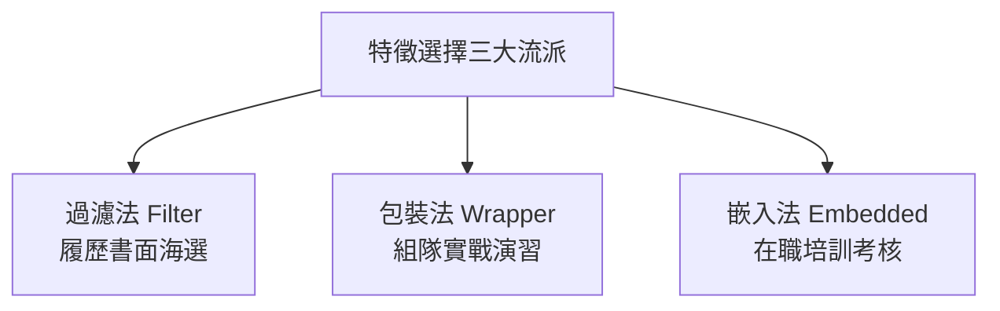

# 🛠️ 特徵工程 (Feature Engineering)

> **「數據和特徵決定了機器學習的上限，而模型和演算法只是逼近這個上限而已。」**  
> —— 機器學習業界核心心法 (Garbage In, Garbage Out)

機器學習模型就像一位**五星級名廚**，而特徵工程就是**備料的過程**（洗菜、去泥、挑選精華部位、精準分切與調味）。  
如果直接把混著泥土、未經處理的粗糙食材（未清洗的原始數據）丟進鍋裡，即便廚師的技術（模型演算法）再高超，也絕對煮不出美味佳餚！

---

## 🧭 學習導航與互動動畫

* 🎬 **視覺化概念與線上互動動畫**：👉 [**名詞解釋：04_特徵工程**](../名詞解釋/04_特徵工程/README.md)
* 🌐 **瀏覽器即時互動體驗**：[特徵選擇動畫](https://roberthsu2003.github.io/machine_learning/glossary/04-feature-engineering/#selection) · [特徵縮放動畫](https://roberthsu2003.github.io/machine_learning/glossary/04-feature-engineering/#scaling) · [類別編碼動畫](https://roberthsu2003.github.io/machine_learning/glossary/04-feature-engineering/#encoding)
* 💻 **實作導覽**：本單元附帶 **12 個精選實作 Notebook**，範例程式碼皆在 [`./examples/`](./examples/) 目錄中，並支援 Google Colab 一鍵線上開啟執行。

---

## 🗺️ 特徵工程完整流程地圖


---

## 📚 核心單元詳解（完全對照實作範例）

---

### 1️⃣ 數據預處理 (Data Preprocessing)
> **核心任務**：清理基礎髒污與空值，確保數據「完整且型態正確」。

#### 1. 處理缺失值 (Handling Missing Values)
在真實數據中，常因感測器故障或用戶未填寫出現空值 (`NaN`)：
* 📓 **對應範例**：[`examples/1_handling_missing_values.ipynb`](./examples/1_handling_missing_values.ipynb)
* **範例數據結構**：
  ```python
  data = {
      'A': [1, 2, np.nan, 4, 5],                       # 數值型缺失
      'B': [np.nan, 2, 3, 4, 5],                       # 數值型缺失
      'C': ['apple', 'banana', 'apple', np.nan, 'banana'] # 類別型缺失
  }
  ```
* **常見處理方案**：
  1. **直接刪除 (`dropna()`)**：丟棄含有空值的整筆樣本。只適合缺失比例極低（< 1%）且資料充足時，否則會白白流失寶貴資訊。
  2. **數值填補 (`SimpleImputer(strategy='mean')`)**：將特徵 A、B 的缺值填補為該欄位的**平均值**（若有離群值可選**中位數 median**）。
  3. **類別填補 (`SimpleImputer(strategy='most_frequent')`)**：特徵 C 為水果名稱，以最常出現的**眾數**（如 `apple`）填補。

#### 2. 數據清洗 (Data Cleaning)
* 📓 **對應範例**：[`examples/2_data_cleaning.ipynb`](./examples/2_data_cleaning.ipynb)
* **範例數據結構**：
  ```python
  data = {
      'age': ['25', '30', '25', '35', '30', '40', '40'],             # 字串型別，且有重複列
      'gender': ['Male', 'Female', 'male', 'Female', 'Male', ...],     # 大小寫混雜 (Male vs male)
      'salary': [50000, 60000, 50000, 70000, 60000, 80000, 80000]
  }
  ```
* **核心清洗步驟**：
  1. **去重 (`drop_duplicates()`)**：自動識別並剔除完全相同的重複紀錄。
  2. **型別轉換 (`pd.to_numeric()`)**：將文字格式的 `'25'` 轉為數值型態 `25`，才能做數學運算。
  3. **文字正規化 (`.str.lower()`)**：把 `'Male'` 與 `'male'` 統一轉成全小寫，避免被模型視為兩種不同性別。

---

### 2️⃣ 類別特徵編碼 (Categorical Encoding)
> **核心任務**：電腦只懂數值矩陣，必須將字串轉換為合適的數字編碼。

#### 1. 標籤編碼 (Label Encoding) —— 適用於「有序」類別
* 📓 **對應範例**：[`examples/3_label_encoding.ipynb`](./examples/3_label_encoding.ipynb)
* **範例數據**：衣服尺寸 `size: ['S', 'M', 'L', 'XL', 'S', 'M']`
* **運作機制**：使用 `LabelEncoder` 直接映射為遞增整數：
  $$\text{S} \rightarrow 0,\quad \text{M} \rightarrow 1,\quad \text{L} \rightarrow 2,\quad \text{XL} \rightarrow 3$$
* 💡 **適用場景**：特徵本身具有明確大小高低順序（如衣服尺寸、學歷、信用評等）。
* 🚨 **避坑警告**：千萬不要拿來編沒有順序的特徵（如顏色、血型），否則線性模型會誤以為「XL 比 S 大三倍」！

#### 2. 獨熱編碼 (One-Hot Encoding) —— 適用於「無序」類別
* 📓 **對應範例**：[`examples/4_one_hot_encoding.ipynb`](./examples/4_one_hot_encoding.ipynb)
* **範例數據**：顏色 `color: ['Red', 'Green', 'Blue', 'Green', 'Red']`
* **運作機制**：為每個顏色展開獨立的二進位欄位（`OneHotEncoder` 或 `pd.get_dummies`）：
  - `Red`   $\rightarrow$ `[1, 0, 0]` (`color_Red=1`, `color_Green=0`, `color_Blue=0`)
  - `Green` $\rightarrow$ `[0, 1, 0]`
  - `Blue`  $\rightarrow$ `[0, 0, 1]`
* 💡 **好處**：各類別在幾何空間中互相垂直對等，不會強加虛假的大小關係。
* ⚠️ **注意事項**：若類別種類過多（如 300 個行政區），會產生大量全為 0 的稀疏矩陣（維度爆炸）。

---

### 3️⃣ 數值特徵縮放 (Feature Scaling)
> **核心任務**：消除單位與量綱差異，避免大數值吃掉小數值。

* 範例情境數據（對應範例 5 與 6）：
  ```python
  data = {
      'age': [25, 30, 35, 40, 45],                       # 數值範圍 25 ~ 45
      'salary': [50000, 60000, 70000, 80000, 90000]     # 數值範圍 50,000 ~ 90,000
  }
  ```
  如果直接計算距離，`salary` 動輒上萬的差距平方後高達數億，會**徹底淹沒 `age` 的微小貢獻**！

#### 1. 標準化 (Standardization / Z-score)
* 📓 **對應範例**：[`examples/5_standardization.ipynb`](./examples/5_standardization.ipynb)
* **數學公式**：$$z = \frac{x - \mu}{\sigma}$$
* **效果**：使用 `StandardScaler()` 轉換後，數據**平均值 $\mu = 0$，標準差 $\sigma = 1$**。
* **特性**：保留了離群值的相對位置，抗極端值能力強；適合大多數依賴梯度下降的模型與神經網絡。

#### 2. 歸一化 (Normalization / Min-Max Scaling)
* 📓 **對應範例**：[`examples/6_normalization.ipynb`](./examples/6_normalization.ipynb)
* **數學公式**：$$x_{\text{scaled}} = \frac{x - x_{\min}}{x_{\max} - x_{\min}}$$
* **效果**：使用 `MinMaxScaler()` 將所有數值嚴格等比例壓縮到 **$[0, 1]$** 區間（最小值變 0，最大值變 1）。
* **特性**：極度敏感於離群值；適合有明確物理邊界的特徵（如像素值 0~255）或 K-NN 距離度量。

> 🛡️ **演算法免疫快查**：
> * **必須縮放 ⚠️**：K-NN、K-Means、SVM、線性/邏輯回歸、類神經網路。
> * **完全免疫 🛡️**：決策樹 (Decision Tree)、隨機森林 (Random Forest)、XGBoost 等**樹狀模型**（只關心數值相對大小順序，不關心絕對尺度）。

---

### 4️⃣ 特徵創造與衍生 (Feature Creation)
> **核心任務**：讓單純的線性模型具備捕捉「彎曲曲線」與「加乘協同效應」的能力。

#### 1. 多項式特徵 (Polynomial Features)
* 📓 **對應範例**：[`examples/7_polynomial_features.ipynb`](./examples/7_polynomial_features.ipynb)
* **範例數據**：原始特徵 $x_1, x_2$（例如 `x1: [1, 2, 3], x2: [4, 5, 6]`）
* **運作機制**：使用 `PolynomialFeatures(degree=2, include_bias=False)` 衍生出：
  $$\text{原始項: } x_1, x_2 \quad\longrightarrow\quad \text{擴展後: } x_1, x_2, \mathbf{x_1^2}, \mathbf{x_1 x_2}, \mathbf{x_2^2}$$
* 💡 **生活比喻**：車速與煞車距離並非直線關係，而是物理學中的動能二次方關係（$E = \frac{1}{2}mv^2$）。引入 $x^2$ 二次項，線性回歸就能擬合優美的拋物線！

#### 2. 交互特徵 (Interaction Features)
* 📓 **對應範例**：[`examples/8_interaction_features.ipynb`](./examples/8_interaction_features.ipynb)
* **範例數據**：原始特徵 $x_1, x_2, x_3$
* **運作機制**：設定 `PolynomialFeatures(interaction_only=True)`，只保留純乘積項：
  $$\text{產生: } x_1, x_2, x_3, \mathbf{x_1 x_2}, \mathbf{x_1 x_3}, \mathbf{x_2 x_3} \quad (\text{排除 } x_1^2, x_2^2, x_3^2)$$
* 💡 **生活比喻**：
  * $\text{長度} \times \text{寬度} = \text{面積}$（比單看長度更具解釋力）。
  * $\text{氣溫} \times \text{濕度} = \text{體感悶熱度}$（兩者加乘才會引發開冷氣的衝動）。

---

### 5️⃣ 特徵選擇 (Feature Selection)
> **核心任務**：去蕪存菁！從 20 個維度中剔除 15 個冗餘雜訊，只留下最關鍵的 5 個特徵。

* 範例情境數據（對應範例 9, 10, 11）：
  使用 `make_classification(n_samples=100, n_features=20, n_informative=5)` 生成 20 個特徵，但其中只有 5 個是真正有用的資訊，其餘皆是雜訊。



#### 📌 三大流派對照表（對應 9、10、11 實作）

| 流派名稱 | 💡 人才招聘生動比喻 | 範例核心代碼 | 運作原理 | 優點與缺點 |
| :--- | :--- | :--- | :--- | :--- |
| **過濾法**<br>*(Filter)* | **書面履歷初篩**<br>（未見面試官前先按分數篩選） | `SelectKBest(score_func=f_classif, k=5)`<br>📓 [`9_filter_methods.ipynb`](./examples/9_filter_methods.ipynb) | 不訓練模型，純計算特徵與標籤的統計關聯（ANOVA F-value / 卡方檢定），挑出最高分前 5 名。 | **優點**：運算速度飛快。<br>**缺點**：忽略特徵之間的組合互補性。 |
| **包裝法**<br>*(Wrapper)* | **實戰組隊模擬賽**<br>（換不同 5 人陣容實測得分） | `RFE(estimator=LogisticRegression, n_features_to_select=5)`<br>📓 [`10_wrapper_methods.ipynb`](./examples/10_wrapper_methods.ipynb) | 用模型當作黑盒子，不斷測試不同特徵子集，**遞歸消除 (RFE)** 最弱的特徵直到剩 5 個。 | **優點**：特徵組合最佳、針對性強。<br>**缺點**：計算成本高（反覆訓練模型多次）。 |
| **嵌入法**<br>*(Embedded)* | **試用期在職實戰考核**<br>（在培訓過程中自然淘汰無用人員） | `LassoCV` 或 `RandomForestClassifier`<br>搭配 `SelectFromModel`<br>📓 [`11_embedded_methods.ipynb`](./examples/11_embedded_methods.ipynb) | 訓練模型時自動完成特徵篩選：Lasso 的 L1 正則化會把無用係數壓成 0；隨機森林會計算不純度重要性。 | **優點**：在挑選品質與計算速度間取得最佳平衡。<br>**缺點**：相依於特定模型演算法。 |

---

### 6️⃣ 降維：主成分分析 (PCA)
> **核心任務**：在盡可能保留原始資料總變異的前提下，把高維空間「投影壓扁」成少數綜合維度。

* 📓 **對應範例**：[`examples/12_pca.ipynb`](./examples/12_pca.ipynb)
* **範例流程**：
  1. 將 20 維數據透過 `StandardScaler()` 進行標準化（PCA 對尺度極度敏感，**必做標準化**）。
  2. 使用 `PCA(n_components=2)` 將 20 個特徵壓縮為 2 個主成分 (`PC1`, `PC2`)。
  3. 檢視 `pca.explained_variance_ratio_`（查看這 2 個主成分保留了原始資料百分之幾的變異量）。
  4. 使用 Matplotlib 繪製 2D 散點圖，直接用肉眼看清原本 20 維空間中 3 個類別的分佈與邊界！
* 📸 **生動比喻**：**「多角度攝影投射」**。想像一隻三維空間中的茶壺，我們旋轉視角找到一個最完美的陰影投影角度，即便投影成二維平面照片，大家依然一眼認出那是茶壺！

---

## 🚀 12 大實作 Notebook 導覽與速查

您可以直接點擊以下 Notebook 連結開啟檔案，或在檔案內點擊 **Open in Colab** 於線上即時執行：

| 步驟分類 | 實作檔案連結 | 核心解決問題與技術 | 範例所用數據與情境 |
| :---: | :--- | :--- | :--- |
| **數據預處理** | 1. [處理缺失值](./examples/1_handling_missing_values.ipynb) | `dropna()`, `SimpleImputer` 均值/眾數填補 | 數值與水果類別空值數據 |
| **數據預處理** | 2. [數據清洗](./examples/2_data_cleaning.ipynb) | `drop_duplicates()`, 型態轉換, `.str.lower()` | 年齡、性別大小寫、薪資重複記錄 |
| **類別編碼** | 3. [標籤編碼 (Label Encoding)](./examples/3_label_encoding.ipynb) | `LabelEncoder` 轉為遞增整數 | 衣服尺寸 `size` (S / M / L / XL) |
| **類別編碼** | 4. [獨熱編碼 (One-Hot Encoding)](./examples/4_one_hot_encoding.ipynb) | `OneHotEncoder`, `pd.get_dummies` 展開為 0/1 | 顏色 `color` (Red / Green / Blue) |
| **特徵縮放** | 5. [標準化 (Standardization)](./examples/5_standardization.ipynb) | `StandardScaler` 轉為均值 0、標準差 1 | 年齡 (25~45) 與薪水 (5~9 萬) 尺度拉平 |
| **特徵縮放** | 6. [歸一化 (Normalization)](./examples/6_normalization.ipynb) | `MinMaxScaler` 等比例壓縮至 [0, 1] | 年齡與薪水壓縮至 0 到 1 區間 |
| **特徵衍生** | 7. [多項式特徵 (Polynomial)](./examples/7_polynomial_features.ipynb) | `PolynomialFeatures(degree=2)` 生成二次項 | $x_1, x_2$ 生成拋物線與交互項 |
| **特徵衍生** | 8. [交互特徵 (Interaction)](./examples/8_interaction_features.ipynb) | `interaction_only=True` 純交叉相乘 | $x_1, x_2, x_3$ 生成純特徵相乘項 |
| **特徵選擇** | 9. [過濾法 (Filter Methods)](./examples/9_filter_methods.ipynb) | `SelectKBest` 依 ANOVA F-value 排名前 5 名 | 20 個分類特徵的獨立統計快篩 |
| **特徵選擇** | 10. [包裝法 (Wrapper Methods)](./examples/10_wrapper_methods.ipynb) | `RFE` 搭配邏輯回歸遞歸淘汰弱特徵 | 20 個特徵逐步淘汰至最佳 5 個 |
| **特徵選擇** | 11. [嵌入法 (Embedded Methods)](./examples/11_embedded_methods.ipynb) | `SelectFromModel` 搭配 Lasso / 隨機森林 | 模型訓練中自動壓制係數與重要性篩選 |
| **降維分析** | 12. [主成分分析 (PCA)](./examples/12_pca.ipynb) | `StandardScaler` + `PCA(n_components=2)` | 20 維數據降至 2 維並完成視覺化散點圖 |

---

## 💡 總結精華口訣

> **「文字編碼看順序，無序獨熱有序標；**  
> **大小悬殊必縮放，距離梯度不跑偏；**  
> **曲線不足造多項，維度過高篩選降；**  
> **備料功夫做得好，普通模型也稱豪！」**
