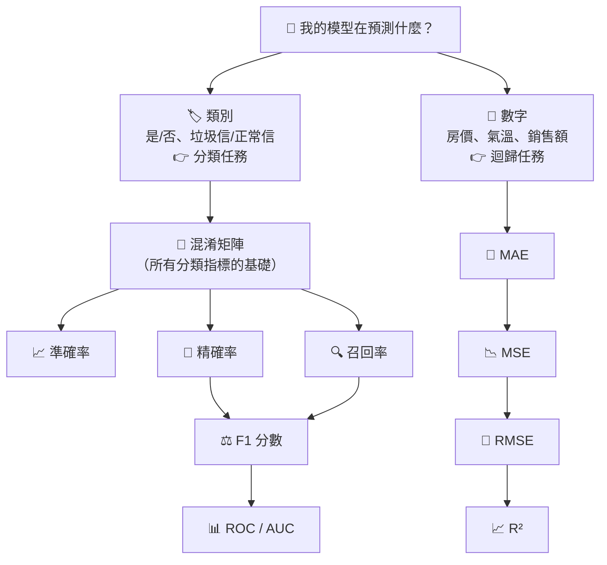

# 📏 評估指標 (Evaluation Metrics)

> **模型訓練完了，到底好不好？** 評估指標就是模型的「**成績單**」。
> 不同的任務要看不同的成績：**分類**看「猜對沒」，**迴歸**看「差多少」。

> [!TIP]
> 🎬 **想看互動動畫版？**
> 👉 [名詞解釋：09_評估指標（觀念詳解與互動動畫）](../名詞解釋/09_評估指標/README.md)
> 👉 [線上互動教材網站](https://roberthsu2003.github.io/machine_learning/glossary/09-evaluation-metrics/)

---

## 🗺️ 學習地圖



### 📚 建議學習順序

| # | 筆記本 | 一句話記住 | 範例情境 |
| :---: | :--- | :--- | :--- |
| 1 | 🧩 [混淆矩陣](./confusion_matrix.ipynb) | 把預測分成 TP / TN / FP / FN 四格 | 🏥 醫院 AI 篩檢 |
| 2 | 📈 [準確率 Accuracy](./accuracy.ipynb) | 猜對的 ÷ 全部 | 📬 垃圾信過濾 |
| 3 | 🎯 [精確率 Precision](./precision.ipynb) | 說「是」的，有幾個真的是？ | 📬 垃圾信過濾 |
| 4 | 🔍 [召回率 Recall](./recall.ipynb) | 真正是的，抓到了幾個？ | 🩺 癌症篩檢 |
| 5 | ⚖️ [F1 分數](./f1_score.ipynb) | 精確率與召回率的綜合成績 | 🔎 搜尋引擎 |
| 6 | 📊 [ROC 曲線與 AUC](./auc_roc_curve.ipynb) | 模型「排序」得好不好 | 💳 信用風險 |
| 7 | 📐 [MAE 平均絕對誤差](./mae.ipynb) | 平均每筆差多少 | 🏠 房價預測 |
| 8 | 📉 [MSE 均方誤差](./mse.ipynb) | 誤差平方再平均，重罰大錯 | ⚡ 用電量預測 |
| 9 | 📏 [RMSE 均方根誤差](./rmse.ipynb) | √MSE，單位變回來 | 🌡️ 氣溫預測 |
| 10 | 📈 [R² 決定係數](./r_squared.ipynb) | 比「猜平均值」進步多少 | 📣 廣告費 vs 銷售額 |

> 💡 每份筆記本都有相同結構：**一句話記住 → 生活比喻 → 公式白話 → 動手做 → 看懂結果 → 常見誤區 → 隨堂練習（附答案）→ 重點回顧**，點開 notebook 上方的 **Open in Colab** 就能直接執行。

---

## 1️⃣ 分類任務：模型猜「類別」

### 🧩 一切的基礎：混淆矩陣

以「醫院 AI 判斷病人有沒有病」為例，每次判斷只會有 4 種結果：

| | 🤖 AI 說：**有病** | 🤖 AI 說：**沒病** |
| :--- | :---: | :---: |
| **實際有病** | ✅ **TP 真正例**<br>抓到病人 | ❌ **FN 假負例**<br>漏診（型二錯誤） |
| **實際沒病** | ❌ **FP 假正例**<br>誤診（型一錯誤） | ✅ **TN 真負例**<br>健康放行 |

> [!IMPORTANT]
> **🔑 背誦口訣：先看後面，再看前面**
> - **後面**的 Positive / Negative = **模型猜了什麼**
> - **前面**的 True / False = **猜對了沒**
>
> 例：**FP** = 模型猜 **P**ositive（有病），但猜錯了（**F**alse）→ 其實沒病 → **誤診**

### 📋 四個分類指標一次看

| 指標 | 公式 | 在問什麼 | 什麼時候最重要 |
| :--- | :--- | :--- | :--- |
| 📈 **準確率** Accuracy | $\frac{TP+TN}{全部}$ | 整體猜對幾成？ | 各類別數量**差不多**時 |
| 🎯 **精確率** Precision | $\frac{TP}{TP+FP}$ | 說「是」的，有幾個真的是？ | **誤報很貴**：垃圾信過濾、推薦系統 |
| 🔍 **召回率** Recall | $\frac{TP}{TP+FN}$ | 真正是的，抓到了幾個？ | **漏報很危險**：癌症篩檢、盜刷偵測 |
| ⚖️ **F1 分數** | $2 \times \frac{P \times R}{P + R}$ | 精確率和召回率都好嗎？ | 兩者都重要、資料**不平衡**時 |

> [!WARNING]
> **準確率陷阱**：100 筆交易只有 5 筆盜刷，一個「**全部都猜正常**」的偷懶模型，準確率高達 **95%**，卻**一筆盜刷都沒抓到**！
> 👉 資料不平衡時，一定要搭配精確率、召回率一起看。

### 🎯 精確率 vs 🔍 召回率：一張圖分清楚

| | 🤖 AI 說有病 | 🤖 AI 說沒病 | |
| :--- | :---: | :---: | :--- |
| **實際有病** | 🟩 **TP** | 🟥 **FN** | ⬅️ **召回率**只看這一列：TP ÷ (TP + FN) |
| **實際沒病** | 🟥 **FP** | ⬜ TN | |
| | ⬆️ **精確率**只看這一欄：<br>TP ÷ (TP + FP) | | |

- **精確率**看「**模型的嘴**」：它說是的，準不準？
- **召回率**看「**真相**」：真正的答案，被找回了多少？
- 兩者常常**此消彼長**：想抓得更完整（召回率↑），通常就會誤報更多（精確率↓）。

### 📊 ROC 曲線與 AUC

模型輸出的通常是**機率**（例如「違約機率 72%」），要選一個**門檻**才能變成是/否。ROC 曲線把**所有門檻都試一遍**：

- **縱軸 TPR**（= 召回率）：「是」的有多少被抓到 → 越高越好
- **橫軸 FPR**：「不是」的有多少被誤判 → 越低越好
- **AUC**（曲線下面積）= 隨機抽一個「是」和一個「不是」，模型給「是」較高分的機率

| AUC | 0.9 ~ 1.0 | 0.8 ~ 0.9 | 0.7 ~ 0.8 | 0.5 |
| :---: | :---: | :---: | :---: | :---: |
| 評價 | 🌟 優秀 | 👍 良好 | 🙂 尚可 | 🎲 跟丟硬幣一樣 |

---

## 2️⃣ 迴歸任務：模型猜「數字」

迴歸沒有「猜對/猜錯」，只有「**差多少**」：

$$\text{誤差} = \text{實際值 } y - \text{預測值 } \hat{y}$$

### 📋 四個迴歸指標一次看

| 指標 | 公式 | 白話 | 單位 | 越…越好 |
| :--- | :--- | :--- | :---: | :---: |
| 📐 **MAE** 平均絕對誤差 | $\frac{1}{n}\sum \lvert y_i - \hat{y}_i \rvert$ | 平均每筆差多少 | 原始單位 ✅ | 越小 |
| 📉 **MSE** 均方誤差 | $\frac{1}{n}\sum (y_i - \hat{y}_i)^2$ | 誤差平方後平均，**重罰大錯** | 單位² ⚠️ | 越小 |
| 📏 **RMSE** 均方根誤差 | $\sqrt{\text{MSE}}$ | 重罰大錯，又能用原始單位解釋 | 原始單位 ✅ | 越小 |
| 📈 **R²** 決定係數 | $1 - \frac{\text{RSS}}{\text{TSS}}$ | 比「每次都猜平均值」進步多少 | 無單位 | **越大**（最高 1） |

### 🔥 為什麼 MSE「重罰大錯」？一個例子就懂

兩個外送 App 預測 5 筆訂單的送達時間，誤差（分鐘）如下：

| | 誤差 | MAE | MSE |
| :--- | :--- | :---: | :---: |
| **App A**（每次差一點） | 10, 10, 10, 10, 10 | 10 | 100 |
| **App B**（偶爾大爆炸） | 0, 0, 0, 0, **50** | 10 | **500** |

MAE 分不出差別，MSE 卻抓出了 App B 有「一次超嚴重的延誤」。

> 💡 **小技巧**：RMSE 一定 ≥ MAE。如果 **RMSE 比 MAE 大很多**，代表有幾筆預測錯得特別離譜，值得找出來檢查。

### 📈 R² 怎麼解讀？

| R² | 意義 |
| :---: | :--- |
| **1** | 完美預測 🌟 |
| **0.8** | 比「每次都猜平均值」誤差少了 80% 👍 |
| **0** | 跟猜平均值一樣 😐 |
| **< 0** | 比猜平均值還差 🙃（R² 是可以為負的！） |

---

## 🧭 速查表：我該看哪個指標？

| 我的情況 | 建議指標 |
| :--- | :--- |
| 分類，各類別數量差不多 | 準確率 + F1 |
| 分類，資料**不平衡**（盜刷、罕見疾病） | 精確率、召回率、F1、AUC（**不要只看準確率**） |
| 「**誤報**」代價很高（誤刪重要信、冤枉好人） | **精確率** |
| 「**漏報**」代價很高（漏診、放過盜刷） | **召回率** |
| 想比較模型「排序」能力、還沒決定門檻 | **AUC** |
| 迴歸，要跟一般人報告「平均差多少」 | **MAE** |
| 迴歸，大錯的代價特別高 | **RMSE**（或 MSE） |
| 迴歸，想知道模型整體解釋力 | **R²**（搭配 RMSE 一起報告） |

## 🐍 sklearn 速查

```python
from sklearn.metrics import (
    confusion_matrix, accuracy_score, precision_score, recall_score,
    f1_score, classification_report, roc_curve, roc_auc_score,      # 分類
    mean_absolute_error, mean_squared_error, r2_score,              # 迴歸
)

# 分類
tn, fp, fn, tp = confusion_matrix(y_true, y_pred).ravel()   # ⚠️ 順序是 TN, FP, FN, TP
print(classification_report(y_true, y_pred))                # 一次看完精確率、召回率、F1
roc_auc_score(y_true, y_proba)                              # ⚠️ 要放「機率」，不是 0/1

# 迴歸
mae  = mean_absolute_error(y_true, y_pred)
mse  = mean_squared_error(y_true, y_pred)
rmse = mse ** 0.5
r2   = r2_score(y_true, y_pred)
```

---

## ❓ 常見問答

<details>
<summary><b>Q1. 準確率 99% 的模型一定很好嗎？</b></summary>

不一定。如果 99% 的資料本來就是同一類，模型「全部猜那一類」就有 99%。請先看看各類別的數量，再搭配精確率、召回率判斷。

</details>

<details>
<summary><b>Q2. 精確率和召回率不能兩個都 100% 嗎？</b></summary>

理想的完美模型可以，但現實中兩者通常此消彼長。調低門檻 → 抓更多（召回率↑）但誤報也變多（精確率↓）；調高門檻則相反。要依情境決定比較在乎哪一個，或用 F1 取平衡。

</details>

<details>
<summary><b>Q3. MAE、MSE、RMSE 要選哪一個？</b></summary>

- 想讓一般人看懂「平均差多少」→ **MAE**
- 大錯特別不能接受 → **RMSE**
- 訓練模型時的損失函數 → 通常是 **MSE**

實務上常同時回報 MAE 和 RMSE，兩者差距大就代表有離群的大錯。

</details>

<details>
<summary><b>Q4. R² 為什麼會是負的？</b></summary>

R² 是「跟每次都猜平均值比」。如果模型在測試資料上預測得比「直接猜平均值」還差，R² 就會小於 0。這通常代表模型過度擬合或根本沒學到規律。

</details>

---

👉 **觀念還想看得更生動？** 前往 [名詞解釋：評估指標視覺化觀念與動畫操作導覽](../名詞解釋/09_評估指標/README.md)
