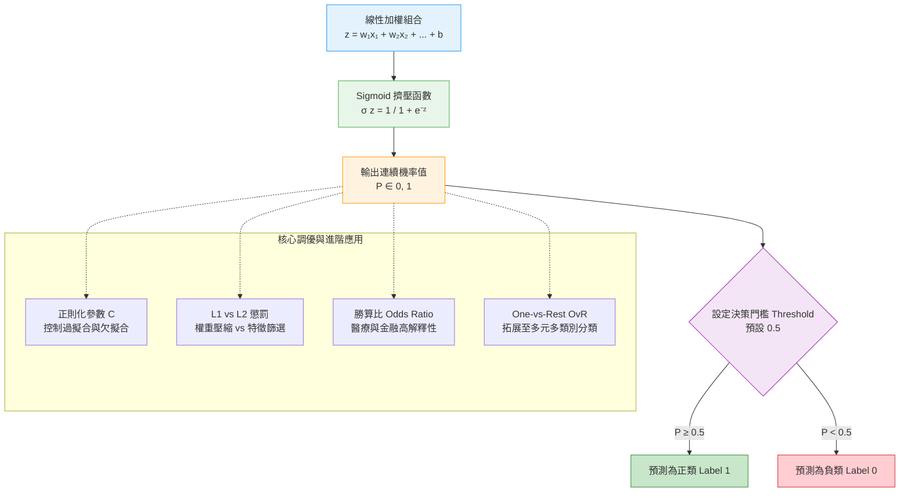
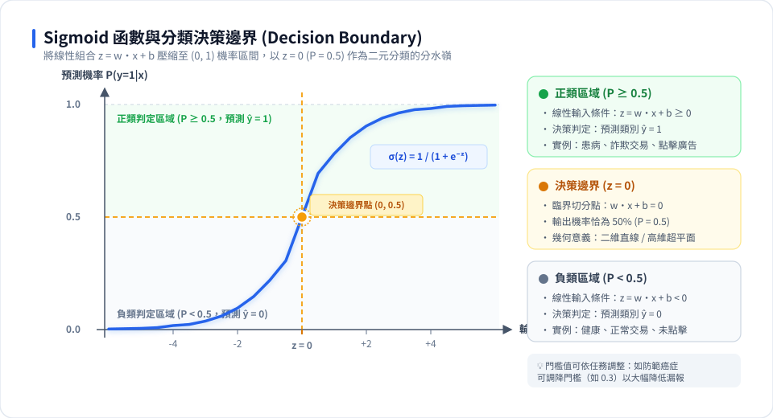

# 🎯 邏輯迴歸 (Logistic Regression) 學習與實戰指南

> **「名字叫『迴歸』，本質卻是『分類』的經典之王！」**  
> 邏輯迴歸（Logistic Regression）是機器學習領域中應用最廣泛、最直觀且解釋性最強的**線性二元分類演算法**。無論是醫療疾病篩檢、金融信用評估，還是廣告點擊預測，邏輯迴歸都是產業實戰中不可撼動的基石。

---

## 🧭 學習導航與互動動畫

> [!TIP]
> 🎬 **想要更生動的幾何決策邊界與分類指標動畫？**  
> 歡迎閱讀：  
> * 👉 [**名詞解釋：07_常見算法 (線性分類篇)**](../名詞解釋/07_常見算法/README.md)（線性超平面決策邊界與距離度量）  
> * 👉 [**名詞解釋：09_評估指標 (分類指標篇)**](../名詞解釋/09_評估指標/README.md#1-分類評估指標-classification-metrics)（分類門檻動態滑動、混淆矩陣、Precision/Recall 此消彼長與 ROC-AUC 曲線）  
> * 🌐 線上互動體驗：[分類指標與門檻滑動動畫](https://roberthsu2003.github.io/machine_learning/glossary/09-evaluation-metrics/#classification-threshold)

---

## 🗺️ 邏輯迴歸學習地圖 (Learning Roadmap)

---

## 💡 核心觀念深入解析（學生必懂五大關鍵）

---

### 1. 為什麼叫「迴歸」，做的卻是「分類」？
* **線性迴歸的困境**：線性迴歸輸出的是連續數值（$-\infty \sim +\infty$）。若拿來預測「是否生病」，預測值可能會跑出 $1.5$ 或 $-0.3$，無法合理解釋為機率。
* **邏輯迴歸的解法**：在線性方程式外面套上一層 **Sigmoid 函數（S型擠壓器）**，把任意數值強制擠壓進 **$[0, 1]$** 區間，變成符合機率公理的數值！

$$z = w_1 x_1 + w_2 x_2 + \dots + b$$
$$P(y=1|x) = \sigma(z) = \frac{1}{1 + e^{-z}}$$

> 📌 **決策邊界 (Decision Boundary)**：  
> 當 $z = 0$ 時，$\sigma(0) = 0.5$。此時方程式 $w_1 x_1 + w_2 x_2 + b = 0$ 就是切割兩種類別的**分界線（在 2D 是直線、在 3D 是平面、在高維是超平面）**！

---

### 2. 正則化參數 $C$：模型的鬆緊調節帶
在 Scikit-Learn 中，`LogisticRegression(C=1.0)` 的參數 `C` 是**正則化強度的倒數 ($C = \frac{1}{\lambda}$)**：

| 參數設定 | 正則化強度 | 對權重 $w$ 的約束 | 決策邊界特性 | 模型狀態 |
| :---: | :---: | :--- | :--- | :---: |
| **小 $C$**（如 `C=0.01`） | **極強** | 強制將所有權重壓得非常接近 0 | 邊界平緩保守，忽略細節 | ⚠️ 易**欠擬合 (Underfitting)** |
| **預設 $C$**（如 `C=1.0`） | **適中** | 平衡擬合精準度與權重大小 | 平滑合理的分割直線 | 🎯 **最佳平衡點** |
| **大 $C$**（如 `C=100`） | **極弱** | 幾乎不約束權重，允許數值很大 | 邊界極力迎合每個樣本點 | ⚠️ 易**過擬合 (Overfitting)** |

---

### 3. 正則化懲罰：L2 泛化 vs L1 特徵篩選
面對幾十、幾百個高維特徵（如基因特徵或文字詞彙）時，可以透過 `penalty` 參數選擇約束方式：
* **L2 正則化（預設 Ridge 模式）**：
  * 特點：約束權重的平方和 $\sum w_i^2$。
  * 效果：**讓所有特徵權重一起變小，但都不為 0**。適合特徵間普遍都有微小貢獻的場景。
* **L1 正則化（Lasso 模式，需設定 `solver='liblinear'`）**：
  * 特點：約束權重的絕對值和 $\sum |w_i|$。
  * 效果：**將不重要特徵的權重直接削為 0（稀疏化）**！
  * 💡 實務價值：自帶**特徵選擇功能**，直接挑出最具關鍵影響力的少數特徵，大幅提高模型可解釋性。

---

### 4. 醫療與金融的最愛：勝算比 (Odds Ratio)
深度神經網路雖然強大，但常被詬病為「黑盒子」；而邏輯迴歸擁有統計學上極為優雅的**臨床與商務可解釋性**：

* **勝算 (Odds)**：事件發生的機率除以不發生的機率：
  $$\text{Odds} = \frac{P}{1 - P} = e^{w_1 x_1 + \dots + b}$$
* **勝算比 (Odds Ratio, $e^{w_i}$)**：
  當某個特徵 $x_i$ 增加 1 個單位時，事件發生的勝算會**乘以 $e^{w_i}$ 倍**！
  * 例如：在糖尿病預測中，空腹血糖係數 $w = 0.05$ ➔ 勝算比 $e^{0.05} \approx 1.05$。  
    **白話解釋**：空腹血糖每上升 $1\text{ mg/dL}$，病患確診糖尿病的風險勝算就增加 $5\%$！

---

### 5. 多元分類如何實現？一對其餘 (One-vs-Rest, OvR)
邏輯迴歸天生是「二分法」，如何預測 3 種或更多類別（如紅花、綠花、藍花）？
* **OvR (One-vs-Rest) 策略**：
  為每個類別各建立一個二元分類器：
  1. 分類器 1：**紅花** vs **(綠花 + 藍花)**
  2. 分類器 2：**綠花** vs **(紅花 + 藍花)**
  3. 分類器 3：**藍花** vs **(紅花 + 綠花)**
* **預測決策**：新樣本輸入時，分別計算 3 個分類器的預測置信分數，**哪一個分數最高，就判定屬於哪一類**！

---

## 📂 實作範例地圖 (Jupyter Notebooks Guide)

本單元設計了完整漸進的 6 大教學筆記本，建議依循以下推薦學習路徑：

| 學習順序 | 實作檔案連結 | 核心教學主題 | 使用數據集 | 實戰精華學習點 |
| :---: | :--- | :--- | :--- | :--- |
| **Step 1** 基礎觀念 | 📖 [**說明1.ipynb**](./說明1.ipynb) | 什麼是邏輯分類？Sigmoid 曲線原理 | 模擬 2D 數據 | • Sigmoid 函數數值推導 • LogisticRegression 與 LinearSVC 幾何邊界比較 |
| **Step 2** 參數調校 | 🎯 [**forge說明2.ipynb**](./forge說明2.ipynb) | 正則化參數 $C$ 與決策邊界調校 | Forge 二元分類數據集 | • 視覺化 $C=0.01, 1, 100$ 的直線邊界變化 • 體驗權重收縮抗過擬合的效果 |
| **Step 3** 高維實戰 | 🔬 [**cancer說明3.ipynb**](./cancer說明3.ipynb) | 高維真實數據與 L1/L2 正則化比較 | 威斯康辛州乳癌數據 (30特徵) | • L2 懲罰 vs L1 稀疏特徵選擇 • 繪製各特徵係數條形圖，找出關鍵致癌指標 |
| **Step 4** 臨床專案 | 🩺 [**03_diabetes_logistic_regression.ipynb**](./03_diabetes_logistic_regression.ipynb) *(延伸部署：[FastAPI+Gradio](../模型部署/糖尿病風險評估-邏輯迴歸/README.md))* | 糖尿病風險預測與勝算比臨床分析 | 真實糖尿病數據 (`Diabetes_Data.csv`) | • 探索性數據分析 (EDA) • 混淆矩陣、ROC 曲線與 AUC 評估 • 臨床勝算比 (Odds Ratio) 深度解讀 • 模型序列化 (`joblib`) 銜接雲端部署 |
| **Step 5** 多元理論 | 📐 [**multiclass_classification說明.ipynb**](./multiclass_classification說明.ipynb) | 多元分類原理 (One-vs-Rest, OvR) | 3 類別模擬資料集 | • 3 條二元直線如何切割二維平面 • 三角重疊區域與未知空間的歸屬判定 |
| **Step 6** 多元實作 | 🌸 [**multiclass_classification實作.ipynb**](./multiclass_classification實作.ipynb) | Scikit-learn 多元分類快速實作 | 經典 Iris 鳶尾花數據集 | • 使用 `LogisticRegression` 輕鬆搞定 3 分類任務 • 混淆矩陣多類別評估 |

---

## 💼 模型部署實務專案：糖尿病罹病風險即時評估服務 (FastAPI + Gradio)

如果您想將本單元訓練好的邏輯迴歸模型封裝為可對外提供服務的雲端微服務，請參考此實務部署專案：

🔗 **[專案目錄：糖尿病風險評估-邏輯迴歸 (FastAPI + Gradio)](../模型部署/糖尿病風險評估-邏輯迴歸/README.md)**

本部署專案完整延伸自本章節的糖尿病臨床案例：
* **[03_diabetes_logistic_regression.ipynb](./03_diabetes_logistic_regression.ipynb)**：糖尿病邏輯迴歸建模、評估與序列化儲存核心筆記本。
* **[practice_train_api_answer.ipynb](../模型部署/糖尿病風險評估-邏輯迴歸/practice_train_api_answer.ipynb)**：模型訓練、標準化與 `/train` API 端點。
* **[practice_predict_api_answer.ipynb](../模型部署/糖尿病風險評估-邏輯迴歸/practice_predict_api_answer.ipynb)**：病患生理指標驗證與 `/predict` API 端點。
* **[practice_gradio_ui_answer.ipynb](../模型部署/糖尿病風險評估-邏輯迴歸/practice_gradio_ui_answer.ipynb)**：Gradio 醫療儀表板與勝算比圖表整合。

---

## ⚖️ 邏輯迴歸優缺點快速總結

### ✅ 優點
1. **速度極快**：計算複雜度低，訓練與線上推論延遲極小，適合高吞吐量生產環境。
2. **輸出連續機率值**：不只能給出分類標籤，還能量化「信心程度」，方便業務端自訂分類門檻。
3. **可解釋性極佳**：係數正負代表特徵對結果的推動方向，勝算比讓業務主管與領域專家輕鬆看懂。
4. **不易受輕微雜訊干擾**：搭配 L2/L1 正則化後泛化能力相當穩健。

### ❌ 局限與劣勢
1. **本質為線性邊界**：無法直接處理複雜的非線性關係（需手動搭配多項式特徵或特徵工程）。
2. **對極端離群值敏感**：未標準化的極端特徵可能大幅拉扯決策直線的截距與斜率。
3. **依賴特徵工程**：特徵間的多重共線性 (Multicollinearity) 會影響係數穩定度與可解釋性。

---

## 💡 學習記憶口訣

> **「迴歸形式定線界，Sigmoid 擠壓化機率；**  
> **門檻決定誰中籤，參數 C 大邊界尖；**  
> **係數指數看勝算，OvR 巧解多分類！」**
